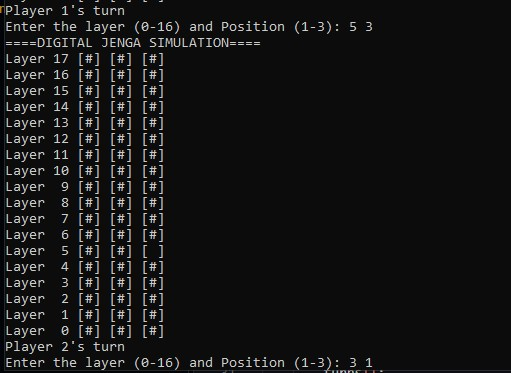
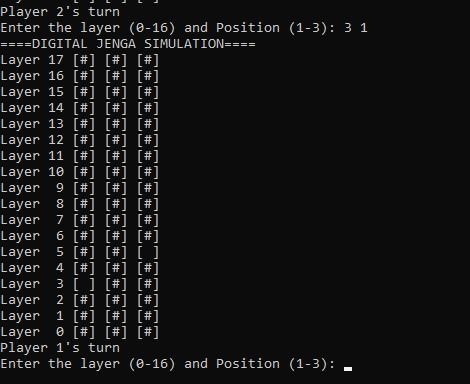
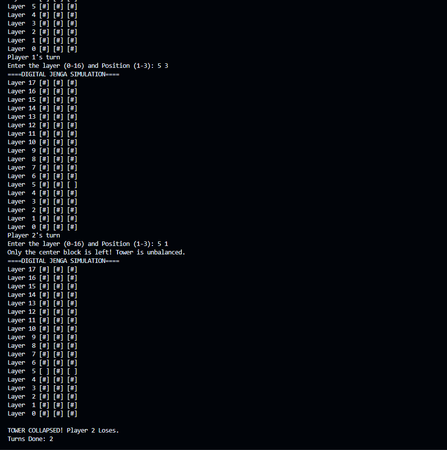
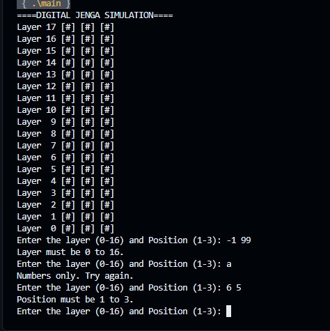

# Digital Jenga Simulation & Balance Engine

Programming Fundamentals PROJECT  
Section: BCS-1B  
26k-0545 Muhammad Mubeen  
26k-0574 Muhammad Khizar

## Project introduction

This is a 2 player Jenga game, written in C, and running in the terminal. The tower stores 18 layers of blocks (3 blocks per layer) in a 2D array and players take turns removing one block at a time. The player who knocks down the tower loses. The tower collapses in four ways: When a layer is empty, When only the middle block of a layer remains, When the bottom layer is too weak, and When an entire column of blocks is removed. If none of these rules are violated, each removal introduces a risk of collapse, which increases with each removal, so that late removals are more dangerous than early ones. While playing the game, it will verify if any of the moves are invalid, record the number of turns played and blocks removed, and save each completed game to a text file using file handling.

## Features and Test Cases

### Case 1: Normal two-player turns

- Description: Checks that the tower prints correctly, a chosen block disappears, and the turn passes between the two players.
- Inputs: `5 1` for Player 1, then `8 2` for Player 2. The first number is the layer (0 to 16) and the second is the position (1 = left, 2 = middle, 3 = right).
- Expected output: The tower is printed again with `[ ]` in the removed spots (layer 5 left, layer 8 middle). The prompt then switches from "Player 1's turn" to "Player 2's turn" and back.

- Screenshot:   
- 

### Case 2: Tower collapse

- Description: Checks that the game ends when a collapse rule is broken, and that the player who made the last move is named as the loser.
- Inputs: `5 3` for Player 1, then `5 1` for Player 2. Both side blocks of layer 5 are now gone, so only the middle block is left.
- Expected output: The message "Only the center block is left! Tower is unbalanced.", then the final tower, "TOWER COLLAPSED! Player 2 Loses.", and the number of turns and removed blocks. The program stops asking for moves. Because of the random strain check, a game can occasionally end earlier with a strain message instead. That is normal.
- Screenshot: 

### Case 3: Invalid input and error handling

- Description: Checks that bad input is rejected with a message, and that the same player is asked again instead of losing the turn or crashing the program.
- Inputs: `99 1` (layer too high), `17 1` (top layer is protected), `5 0` (position out of range), `a` (letters instead of numbers), and a block that was already removed.
- Expected output: A message such as "Layer must be 0 to 16.", "Position must be 1 to 3.", "Numbers only. Try again." or "That block is already removed.", followed by the same prompt again for the same player.
- Screenshot: 

### Case 4: Saving and showing high scores

- Description: Checks that a finished game is written to `records.txt` and that the saved results can be displayed. It also checks that the program does not crash when the file does not exist yet.
- Inputs: Play one game until the tower collapses, then open the high scores option. Run it once before any game has been played as well.
- Expected output: A line like `Loser: Player 2 | Turns: 3 | Blocks removed: 3` for each finished game. With no file yet, the program prints "No records yet."
- Screenshot: 

## How to clone and run

### Step 1: Clone the repository

Open a terminal and run:

```
git clone https://github.com/mubeenshaikh10/digital_jenga_simulation.git
cd digital_jenga_simulation
```

### Step 2: Compile the code

```
gcc main.c -o jenga
```

### Step 3: Run the program

Windows (Command Prompt):

```
jenga
```

Linux or macOS:

```
./jenga
```

The file `records.txt` is created in the folder you run the program from.
